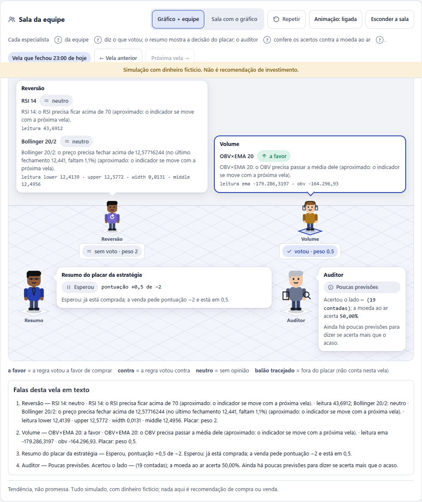
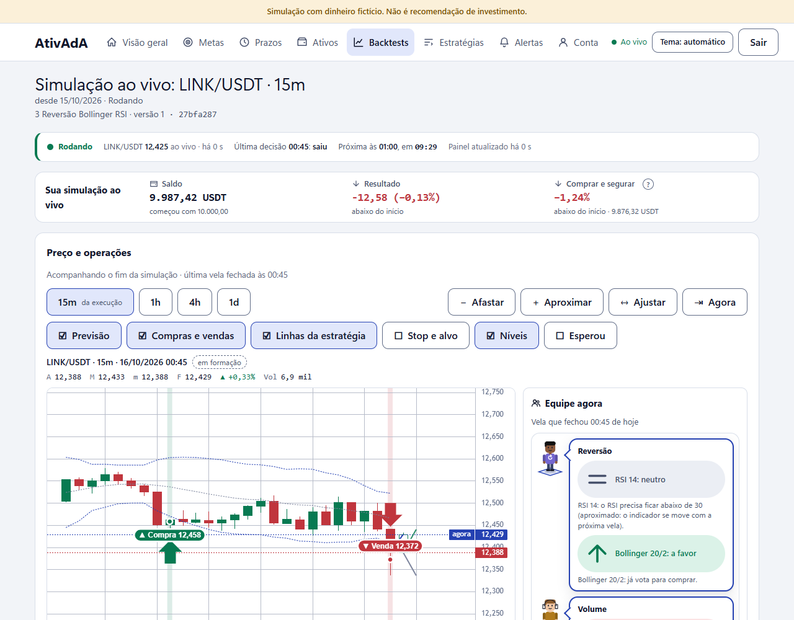

# Evidência — Spec 011

## Decisões do usuário (spec §10)

_Sem resposta registrada._

## Respostas do usuário às decisões do spec.md §10 (registro de 2026-10-15)

O usuário (Anderson) respondeu "pode seguir" às escolhas recomendadas: D1-A (cartão próprio recolhível), D2-A (animação só
na vela nova, com botão de desligar), D3-A (plaquinha com a situação real do auditor), D4-A (motivo curto por regra no
balão; muda o contrato da spec 007 e só começa com a Fase 3 da 007 fechada), D5-A (personagens em SVG), D6-A (janela de
30 dias) e D7-A (rever velas anteriores).

Pedido adicional do usuário: a equipe também deve aparecer NA TELA DO GRÁFICO (versão compacta ao lado do gráfico,
"Próxima vela de perto"), ajudando a enxergar as decisões. Regra: a sala mostra a opinião e o motivo de cada agente; quem
decide continua sendo o analista na simulação, e a tela nunca fala em nome do usuário nem soa como recomendação.

Pedido adicional (2026-10-15, "ou o gráfico na sala"): além da versão compacta da equipe ao lado do gráfico, deve existir o
modo inverso, a sala com o gráfico dentro dela (um "monitor" na parede da sala de negociação, com os balões apontando
para a vela e a linha que cada agente comenta). Os dois modos são uma única escolha de layout (alternância "Gráfico +
equipe" / "Sala com o gráfico"), com o mesmo conteúdo e as mesmas frases do servidor. Entra como decisão D8 do spec 011
(padrão: A = alternância com os dois modos; B = só um deles) a detalhar na T0.1 da 011, após a Fase 3 da spec 007.

## Versão 1 sem o analista (2026-10-15)

Pedido do usuário: ver a sala já, sem esperar o analista de risco da spec 007. A versão 1 usa SÓ dados que existem hoje
(`live-status`, `decisions` e o resumo de `projections`); nada da 007 (rotas, `ruleVotes`, migration, worker) foi tocado.
Decisões aplicadas: D1-A (cartão próprio recolhível), D2-A (animação só na vela nova, com botão), D3-A (plaquinha com a
situação real), D5-A (SVG), D6-A, D7-A (rever velas) e D8 (alternância "Gráfico + equipe" / "Sala com o gráfico"). D4-A (motivo
por regra via `ruleVotes`) fica fora: o balão usa a frase que o servidor já manda por regra em `triggers.rules[].message`
(só na vela mais recente) e, nas velas revistas, o voto e a leitura gravados na decisão.

### De onde vem cada fala (nenhuma é inventada)

| Na tela | Fonte |
|---|---|
| Os "especialistas" (Tendência, Reversão, Volume, Sentimento, "Outras regras") | regras de `decisions.items[0].votes`, agrupadas pela família do `kind` (vocabulário do ADR 0002); só aparece a família que a estratégia tem |
| Voto, peso e "leitura" | `votes[].vote`, `weight`, `isMissing`, `reading` |
| Frase do balão | `triggers.rules[].message` (servidor) |
| "Resumo do placar da estratégia" (no lugar do analista) | `outcome` (Esperou, Comprou, Vendeu…), `score` contra `scoreThreshold` e `message` da decisão |
| Auditor | `summary` de `GET /projections`: `verdict`, `hits`/`counted`, `wilson`, `message`, `verdictMessage`; "moeda ao ar" 50,00% |
| Textos de interface (não são falas) | "Sala da equipe", "Repetir", "Animação", "← Vela anterior", "Voltar para agora", legenda, "A equipe não tem opinião nesta vela…", "Sem simulação rodando agora…" |

Estado é ícone + palavra + cor (a favor ↗, contra ↘, neutro =, sem leitura ⓘ; "votou", "sem voto", "fora do placar").

### Tasks e commits

| Task | Commit |
|---|---|
| T1 modelo (famílias, tons, plaquinha, auditor), sequência pura, preferência, glossário | `84f3a3d` |
| T2 palco (SVG, balões, plaquinhas, piso, tokens) | `12a651d` |
| T3 cartão, sequência na vela nova, rever velas, lista de texto, equipe compacta | `ff11428` |
| T4 alternância de layout e ligação no detalhe da simulação ao vivo | `8ba3ea1` |

### Provas

- Contratos novos na lista explícita do script `test`: `team-room-model.contract.ts` (15) e `team-room.contract.tsx` (17: vela nova,
  equipe sem opinião, auditor com menos de 30 previsões, sem simulação rodando, palco `aria-hidden` sem focável, lista de texto
  = palco, animação só na vela nova com `aria-live` uma vez, animação desligada, `prefers-reduced-motion`, rever velas,
  recolher, alternância de layout, equipe compacta, varredura de palavras proibidas e nenhum `Number(`).
- Contraste: pares novos em `contrast.contract.ts` (bordas 3:1) nos dois temas; alvos de 44 px em `touch-targets.contract.ts`
  (`.tool`, `.switchButton`, `.linesSummary`); `design-review` sem `style=` e com `prefers-reduced-motion` em todo CSS com movimento.
- Sequência: pensa 450 ms, um especialista a cada 120 ms, o resumo pensa 250 ms e fala 300 ms, anúncio 200 ms depois; o contrato
  prova ≤ 1,8 s até com 5 lugares. Durações das animações só em tokens (`--motion-fast`, `--motion-medium`, `--ease-out`).
- App dev real (`/backtests/01a14175-02ae-73ae-ba93-86c0591f7a2c`), por texto: estratégia com Reversão (RSI, Bollinger) e Volume
  (OBV); sem rolagem horizontal a 1280 e 375 px; zero focável no palco; "Equipe agora" ao lado de "Próxima vela de perto";
  "Sala com o gráfico" põe o gráfico no monitor da sala e a escolha fica no `localStorage`; auditor com "Poucas previsões"
  (19 contadas). Captura final: `capturas/versao-1-1280-claro.png`.

### Pendências (versão 1)

- Falas finais do analista de risco (postura, ritmo, tamanho, travas, "Modo sombra") e `ruleVotes`/`motive` por regra: dependem
  da 007 (Fases 2 e 3) e entram na spec 011 completa.
- Plaquinha com acerto por especialista e prancheta com o intervalo de Wilson por barra: o servidor só mede a estratégia inteira
  hoje; a versão 1 mostra o resumo do auditor em texto.
- Capturas por tema a 375 px e E2E com `pg_notify` (T3.1 e T3.2 da spec completa).

## Equipe junto do gráfico (2026-10-16)

Pedido: "os nossos agentes mais perto do gráfico, dando as opiniões ali mesmo, para acompanharmos tudo em tempo real".
Nada da 007 (api, worker, packages) foi tocado; só `apps/frontend-ativada`.

### Commits

| Task | Commit |
|---|---|
| Ordem da página: pulso → "Sua simulação ao vivo" → gráfico; decisões, acompanhamento, acertos e sala grande depois | `b21633d` |
| Coluna "Equipe agora" colada no gráfico (≥ 1100 px; no celular logo abaixo) e fala de cada agente na vela apontada | `f570ae3` |
| Compras e vendas bem visíveis (faixa na vela, ponto com halo, etiqueta com seta + palavra + preço, dica "Compra a X · taxa Y") | `42b3353` |
| Camada "Níveis" (entrada, alvo, stop ou gatilho da regra de preço) | `d6a8c7e` |

### Onde o gráfico começa (Playwright + Edge, app dev real, 1280 px, tema claro, sem aviso de dado antigo)

| Medida | Antes | Depois |
|---|---|---|
| Cartão "Preço e operações" (topo) | 2.731 px | ~374 px |
| Canvas do gráfico | 3.299 px | ~600 a 625 px (as camadas, o período e o aviso ficaram abaixo do gráfico; barra de tempos e de zoom em uma linha) |
| "Equipe agora" | 3.901 px | no alto, ao lado do canvas (mesmo `top` do canvas) |
| Rolagem horizontal | 0 | 0 a 1280 px e a 375 px |

No celular (375 px) a equipe vem logo abaixo do gráfico, em lista; "Próxima vela de perto" depois dela.

### Opinião em tempo real

- A coluna lê a MESMA consulta do acompanhamento (`useLiveStatusQuery`); o aviso do stream só refaz essa consulta. Vela nova
  dispara a sequência curta existente (pensa 450 ms, um a um, resumo por último; ≤ 1,8 s), desligável pela chave "Animação"
  da sala e anulada por `prefers-reduced-motion`. Preço ao vivo mudando NÃO re-anima (a chave é o `candleTime` mais recente).
- Cruz do mouse ou do teclado: `useCandleCanvasModel` já tinha o índice apontado (`hoverIndex ?? keyboard.index`); agora
  entrega `pointedOpenTime` à equipe pelo contexto `TeamAside` (função que recebe a vela apontada). Nenhum estado novo.
  `pickDecisionForCandle` acha a decisão da vela (mesma abertura ou, em outro tempo gráfico, a que cobre o instante);
  vela revista usa só voto e leitura gravados (a frase por regra do servidor existe só na mais recente), sem animação;
  vela sem decisão diz "Esta vela não tem falas gravadas…".
- Com a sala grande recolhida, o aviso do leitor de tela (`aria-live`) passa para a coluna.
- Honestidade: só falas do servidor; "Tendência, não promessa. Tudo simulado…" na coluna; palavras proibidas varridas por teste.

### Marcadores de compra e venda

Primitivo novo `trade-marks-primitive.ts` (sem importar a biblioteca): faixa suave na vela, ponto no preço do preenchimento
com halo (cor do fundo), etiqueta "▲ Compra 12,458" / "▼ Venda …" (cor semântica `--buy`/`--sell`, texto na cor do fundo: os
pares `surface`/`buy` e `surface`/`sell` já estão em `contrast.contract.ts`), agrupamento "Compras ×3" quando próximas
(menos de 96 px), seta da biblioteca maior (tamanho 2, 3 se selecionada). Ao apontar a vela, a legenda diz
"Compra a 12,45 · taxa 0,01". Custo: só os marcadores visíveis (≤ 500) por quadro, desenho de canvas simples; o teste de
quadros por segundo da T3.8 não foi alterado.

### Níveis da estratégia nesta simulação

Camada "Níveis" (padrão ligada; só desenha com dado): posição aberta = entrada, alvo e stop do `openPosition` do
`live-status`; sem posição = a regra de PREÇO que ainda não votou a favor ("Bollinger 20/2 vota a favor se fechar acima de
12,53"). No máximo 3 linhas. Valores em texto do servidor (`formatPrice`), conversão só por `toDrawingNumber`. O aviso diz
que são níveis desta simulação, não previsão de preço nem recomendação. Nos balões da equipe, a frase do servidor por regra
("o RSI precisa ficar acima de 70…") já traz o valor ao lado do especialista. Reaproveita a consulta do acompanhamento; a
camada "Stop e alvo" (caixas por operação) segue como estava.

### Provas

- `test/team-beside-chart.contract.tsx` (10): ordem da página, resumo curto, vela apontada pelo teclado chega à equipe e Esc
  volta a "agora", `pickDecisionForCandle`, vela antiga sem a frase viva, vela sem fala, vela nova pensa/fala/descansa, refetch
  do preço não anima, animação desligada.
- `test/trade-marks.contract.ts` (6) e `test/strategy-levels.contract.tsx` (5); `surface-style`, `chart-series` e
  `chart-preferences` ajustados (campos novos).
- Gates: `tsc` do painel limpo, `eslint` do painel limpo, `panel-test` 1.120 passam, 0 falham. Falha da raiz só em arquivos da
  007 (`typecheck` da raiz e `format:check` em `scripts/live-mutants.ts`), ignorada.
- Capturas: `capturas/equipe-junto-do-grafico-1280-claro.png` e `capturas/equipe-junto-do-grafico-375-escuro.png`.

### Pendências

- O canvas fica em ~600 a 625 px (card em ~374 px), não abaixo de 600 de forma folgada: o que sobra acima dele é o cabeçalho
  da execução (3 linhas), a linha de pulso e o resumo.
- A coluna da equipe (≈ 900 px com 3 famílias e frases longas do servidor) é mais alta que o canvas (620 px): sobra espaço à
  esquerda abaixo do gráfico no desktop.
- A "Sala com o gráfico" mantém o gráfico dentro da sala (sem a coluna); a equipe compacta não aparece nesse layout.
- Rever velas da sala grande e a vela apontada no gráfico são seleções independentes (sem estado compartilhado, por pedido).

## Equipe não aparecia (2026-10-16)

Relato: "no gráfico mais equipe não está aparecendo". Conferido no painel de desenvolvimento (Edge, 1280 px, tema claro, login
local de teste) nas quatro execuções abaixo, por DOM, rede e console; capturas em `capturas/` do scratchpad da sessão.

| Execução | Antes | Depois |
|---|---|---|
| LINK 15 min, 1 operação, sem analista | coluna "Equipe agora" presente (361 px, ao lado do canvas de 756 px) | igual |
| LINK 15 min com analista | presente | presente |
| PEPE recém-criada | coluna presente só depois da 1ª decisão; antes dela e com o gráfico sem velas, nada | coluna ao lado do aviso do gráfico, com "A equipe ainda está olhando o mercado…" |
| Backtest `01a131cd…` | **nenhuma coluna**; o canvas (756 px) ficava com a coluna da direita vazia | coluna "Equipe agora" com a frase honesta de execução histórica |

Causas encontradas (cada uma reproduzida por contrato em `test/team-always-beside-chart.contract.tsx`):

1. **Sem decisões ainda** (`useCompactTeamModel` devolvia `undefined` e o `CompactTeam` renderizava `null`): simulação recém-criada
   ou parada antes da 1ª vela não tinha equipe. Agora diz "A equipe ainda está olhando o mercado. A primeira opinião chega quando a
   vela de N fechar às HH:MM." (hora no fuso do usuário, de `nextDecisionAt`) ou, parada, "não está rodando".
2. **`live-status` carregando, 409/429/5xx** (`useLiveStatusQuery` sem dado): o componente renderizava `null`; uma resposta 429 do
   limite de renovação (visto várias vezes no dev) fazia a equipe sumir sem aviso. Agora a moldura fica, com "Carregando a equipe…"
   ou "Não deu para carregar a equipe agora." e o botão "Tentar de novo".
3. **Backtest e walk-forward**: `CompletedBacktest`/`CompletedWalkForward` desenham o gráfico fora do `TeamAsideProvider`, e o
   `CandleCanvas` só montava a coluna com `view.isLive`. Agora a coluna existe e diz "Esta execução roda sobre o passado: a equipe só
   opina nas simulações ao vivo. As compras e vendas estão marcadas no gráfico." (backtest não grava falas; não há dado por vela).
4. **Simulação ao vivo concluída** (`hasChart` falso no `LiveChartArea`; o gráfico vem do `CompletedBacktest`): sem provedor, sem
   equipe. Agora `RunTeamAside` dá a equipe compacta à execução ao vivo terminada.
5. **Gráfico que não chega ao canvas** (carregando as velas, "Ainda não há velas para mostrar", velas públicas ausentes, canvas
   que falhou): a coluna morava dentro do `CandleCanvas`, então sumia junto. Agora `BesideTeam` reserva a mesma coluna ao lado desses avisos.
6. **Layout "Sala com o gráfico" salvo no navegador** (`ativada.team-room`): a equipe compacta some por desenho, e a sala sem
   decisões, carregando ou com erro **não renderizava o monitor**: o gráfico inteiro desaparecia e não havia botão para voltar.
   Agora esses estados mantêm o gráfico (monitor) e o seletor "Gráfico + equipe | Sala com o gráfico" fica visível no cartão.
7. Largura < 1100 px: não é causa; a coluna desce para logo abaixo do canvas (CSS `min-width: 1100px` já existia).
   `isCollapsed` não esconde a equipe compacta (só a sala grande).

Verificação: typecheck, lint e format do painel limpos; `bun run --cwd apps/frontend-ativada test`: 1231 testes verdes (100
arquivos). Testes antigos que seguravam o elemento "Equipe agora" passaram a esperar a opinião chegar (`test/support/loaded-team.ts`),
porque a moldura agora existe desde o carregamento. Para ver no navegador: Ctrl+F5 (o Vite recarrega sozinho, mas o painel de
produção precisa de novo build).

### Pendências

- Backtest não mostra a equipe "da vela apontada": o motor não grava falas por vela em backtest (nem há rota); a coluna diz isso.

## Varanda no app (2026-10-16)

Autorização: o usuário cobrou as melhorias de tela do preview no app ("cadê as melhorias de tela que você apresentou") e isso vale
como autorização para implementar a INTERFACE do adendo `escritorio.md` com as decisões **D-E1 a D-E13 todas A** (vista frontal;
crachá sempre visível; agentes com propósito; modelos na faixa como "em breve"; palco ACIMA do gráfico; faixa ≤ 220 px; ranking
pelo limite inferior de Wilson; escada só como cena futura). Sem migration, sem mudar o motor, sem mudar rotas existentes.
Referência: `docs/preview/escritorio/index.html` (`#cena=grafico-equipe`).

### (1) Equipe sempre em tela

- **Onde:** `src/runs/team-room/balcony/` (novo): `TeamBalcony` (moldura "Equipe agora", cabeçalho com a vela, legenda
  "● Regra ◆ Modelo" e a linha fixa), `BalconyCrew`, `BalconyAgentSlot` (bonequinho, crachá e balão), `BalconyBoard` (lousa com abas),
  `balcony-agents.ts` (puro: dados da equipe → seis agentes), `useBadgeSheet` (ficha: clique/Enter abre, Esc e clique fora fecham,
  o foco volta ao crachá). Substitui a coluna lateral: `renderCompactTeam` agora monta a varanda, o `CandleCanvas` a põe ACIMA do
  gráfico e o `BesideTeam` a empilha acima dos avisos do lugar do gráfico. `CompactTeam` (coluna) segue no código, sem uso na tela.
- **Dados:** nada de consulta nova; mesmas frases do servidor da coluna antiga (`useCompactTeamModel`). Tiago, Renata, Vitor e Sofia
  são as famílias de regras; Alice é o analista de risco (ou o resumo do placar, quando a simulação não tem analista); Otávio é o
  auditor (resumo de acertos de `/projections`).
- **Honestidade do selo:** o servidor ainda não mede o acerto por especialista, então o selo dos quatro diz "Sem medida" (e a ficha
  diz que o auditor mede só o resumo geral). Alice "Decide" e Otávio "Mede". Balão tracejado "não vota" = fora do placar.
- **Altura útil:** o gráfico passa a ter altura `clamp(240–640 px, 100dvh − 440 px)`; a varanda fica `sticky` (equipe sempre em tela
  ao rolar o gráfico) e o detalhe da simulação ao vivo abre pelo gráfico com a equipe (cabeçalho, pulso e resumo vêm logo depois).
- **Celular (< 700 px):** barra fixa no topo com os avatares e um balão por vez (o do último crachá tocado); a lousa vira folha
  que sobe do rodapé ("Lousa da equipe: proteções e ranking").
- **Tokens novos** (`global.css`, claro e escuro): `--motion-walk`, `--model` (+ `--model-soft`), `--board`, `--board-ink`, `--postit`,
  `--postit-ink`, `--office-wall`, `--desk-edge`, `--glass`; pares `model/surface` e `postit-ink/postit` no `contrast.contract.ts`.
- **Testes:** `test/team-balcony.contract.tsx` (5), `team-beside-chart` ajustado à nova ordem (gráfico antes do resumo).

## Equipe em backtests (2026-10-16)

Relato: "não vejo a equipe" no backtest da PEPE 15 min (`01a131cd…`): a coluna só trazia a frase "a equipe só opina nas simulações ao vivo".

**Viabilidade (conferida antes de mexer).** O backtest e o walk-forward gravam UMA linha de `signals` por vela com `votes` (voto, peso e
ausência por regra) e `indicators` (as leituras), pelo mesmo `appendDecisions` do ao vivo (`packages/run-recording`); no walk-forward
`createTestCollection` grava só as velas das janelas de TESTE (o candle-âncora e o ajuste ficam de fora). São as linhas que o
`listDecisionRows` já lia no ao vivo. Portanto não foi preciso mudar `strategy-engine` nem `run-recording`, nem migration.

**API (aditiva).**

- `GET /v1/runs/:runId/decisions` passa a valer para `live_paper`, `backtest` e `walk_forward` (`findSignalRun`, tipos em
  `SIGNAL_RUN_KINDS`; tipo sem sinais gravados continua `409 RUN_NOT_LIVE`). `live-status` e analista seguem só ao vivo
  (`findLiveRun`). O contrato antigo do ao vivo não mudou (mesmo envelope, mesmas 4 consultas, mesmo `404` para alheia, inexistente
  e apagada).
- `?at=<ms>` novo: a página começa na vela de abertura pedida, inclusive, e segue para as anteriores (`before = at + 1` no mesmo
  `listDecisionRows`; zero consulta nova). `at` junto com `cursor`, ou malformado, é `400`. Vela sem decisão devolve a anterior mais
  próxima (o painel confere se ela cobre a vela apontada).
- Nas históricas a última vela não vira "compra pendente": a execução terminou, não há "vela seguinte que ainda não abriu"
  (`lastCandleTime` só entra para `live_paper`).
- OpenAPI e esquema Zod de query (`runDecisionsQuerySchema`) atualizados. Frases do servidor, `scoreThreshold` e votos saem do mesmo
  código do ao vivo. Limite conhecido: no walk-forward os rótulos e limiares vêm da configuração da VERSÃO da estratégia; a grade
  do walk-forward ajusta parâmetros das regras (nunca `thresholds`), então os limiares batem; um rótulo com o período ajustado
  de uma janela pode mostrar o período da versão.
- Provas: `test/api-run-decisions-history.contract.test.ts` (8: backtest e walk-forward, paridade com o ao vivo, última vela,
  `at`, `at`+`cursor` e malformado 400, `404` igual entre usuários), `api-run-live-status` ajustado (live-status segue 409 para
  histórica), 7 mutantes novos em `api-run-live-status-mutants` (tipos recusados, `at` ignorado ou exclusivo, `at`+`cursor`
  aceito, compra pendente na histórica, `live-status` aceitando histórica); o teste novo entra no julgamento dos mutantes.

**Painel.** `renderHistoricalTeam(runId, timeframe)` (`HistoricalTeam.component.tsx`, no lugar de `BacktestTeam`) mostra os crachás
e balões (voto + leitura gravada + frase do servidor da vela), o resumo do placar como "analista" (sem analista de risco) e o auditor
com o resumo de `/projections`; "Última vela da execução, fechou …" por padrão e "Vela apontada no gráfico, fechou …" ao apontar
outra (mouse ou teclado). Sem decisão para a vela (aquecimento, ajuste do walk-forward, antes do início) diz a frase honesta; o
servidor recusando mantém a coluna com "Tentar de novo". Consultas: `decisions?limit=1` para a última e UMA janela de 100 velas por
bloco alinhado (`at` = fim do bloco, `windowAnchorFor`) que serve todas as velas vizinhas apontadas (cache, sem consulta por vela
apontada; respeita o balde de 60/min compartilhado). Não recalcula nada no navegador. `CompactTeamSeats` e `CompactTeamMoment`
foram extraídos de `CompactTeam` (sem mudar o ao vivo) e a grade `wide` põe os assentos lado a lado quando a equipe está acima do
gráfico em largura total. `RunTeamAside` ganhou `timeframe`.

**No app dev real (Edge, 1280 px, claro, usuário de teste), por DOM e rede:**

- Backtest PEPE 15 min `01a131cd…`: última vela "fechou 30/09/2026 21:00" com Tendência (EMA 20×50: contra), Reversão (RSI 14:
  neutro), Sentimento (sem leitura, fora do placar), resumo "Esperou, pontuação −1 de +2" e Auditor "Abaixo da moeda ao ar, 48,72%
  (5546 de 11382)"; 6 velas para trás pelo teclado: "Vela apontada no gráfico, fechou 30/09/2026 19:45" com RSI (53,4) e a
  frase da vela. Rede: `decisions?limit=1` e `decisions?limit=100&at=…` (uma só janela para as 6 velas).
- Walk-forward `01a131c6-f8e3…`: última vela com EMA 9×21 a favor, MACD contra, "já está comprada; a venda pede pontuação −2 e
  está em −1", e a vela apontada 20 h antes com outra pontuação.
- Captura final (claro, 1280): equipe com a vela apontada, assentos em grade e auditor.

**Verificação.** typecheck limpo; testes do painel (`historical-team.contract.tsx` novo, na lista do script `test`;
`team-always-beside-chart` ajustado); API: `api-run-decisions-history`, `api-run-live-status*`, `api-runs*`, `api-openapi`,
`ownership-registry`, `code-size-limits` verdes. Falhas vistas no `lint`, `format` e no `overview` do painel são de arquivos de
outras frentes em andamento (notices, overview, varanda).

### Pendências

- A coluna histórica usa a moldura `CompactTeamFrame` (não a varanda da spec 013, em obra): quando a varanda estabilizar, o
  `HistoricalTeam` pode trocar a moldura mantendo `useHistoricalTeamModel` (mesmos campos que o balão consome).

### (2) Plaquinhas de compra e venda

- `balcony/TradePlaques` (abaixo do gráfico, `LiveChartArea`): **COMPRA** (líquido no alvo grande, bruto, USDT pequeno, proteção e ganho ÷ risco),
  **COMPRADO desde HH:MM** (líquido se vender agora, com o preço de agora) e a última saída (**VENDA** no alvo ou **SAÍDA PELA PROTEÇÃO**, com o
  líquido que o servidor gravou). Ícone + palavra + cor; zero é cinza com "=".
- Conta em `protection-math.ts` (BigInt, escala 8, sem `Number` em dinheiro): custo da compra com deslizamento e taxa para cima, receita da venda com os
  dois para baixo, divisão para baixo (ganho nunca sobra, perda nunca encolhe), menos tipográfico. Taxa e deslizamento vêm de `runParameters` da execução;
  sem eles a plaquinha da compra e a da operação aberta não aparecem (nada inventado). Contrato `balcony-protection.contract.ts` (11), com oráculo independente.
- A ficha do sinal e a régua Proteção · Entrada · Alvo já existiam (spec 014, `SignalCard` e `LevelRuler`): não foram duplicadas.

### (3) Proteções explícitas

- **Gráfico:** a linha do stop passou a se chamar "PROTEÇÃO CONTRA QUEDA · sugestão de venda aqui" (rótulo da linha de preço, com o valor no eixo).
- **Lousa, aba "Proteções"** (primeira): proteção contra queda (preço, líquido e USDT), a frase "Se cair a X, vende aqui (−Y% da entrada) para limitar a perda. É a
  regra da simulação, não uma ordem.", barra de distância até a proteção (ícone + palavra + cor: longe acima de 50% da folga, perto de 20% a 50%, muito perto
  abaixo de 20%; "faltam N% até a proteção") e o alvo de ganho com o líquido. Sem operação aberta a aba diz isso.
- **Pendente:** proteção por tempo, trava e lucro mínimo na lousa (o `live-status` não os traz por operação; ficam para quando a spec 007 expuser), e o botão
  "Copiar" da proteção (a spec 014 já tem "Copiar" na ficha do sinal).

### Densidade e viewports úteis (feedback "ainda não coube tudo na tela")

- **Densidade** (`balcony-density.ts`, `useBalconyDensity`): `confortável` a partir de 800 px de altura, `compacto` de 640 a 799 (sem bonequinho, balão de 1 linha,
  lousa com altura contida) e `recolhida` abaixo de 640 (só avatares com selo, UM balão por vez, lousa fora, botão "Expandir equipe"). Botão "Compacto /
  Confortável" visível, lembrado em `localStorage` (`ativada.balcony-density`, com try/catch); a medida segue o redimensionamento e o zoom. O gráfico mantém no
  mínimo 320 px (`clamp(320px, 100dvh − 440px, 640px)`, e `− 330px` com janela baixa). Contrato `balcony-density.contract.ts` (4).
- **Medida no app dev (Edge, scrollY = 0, sem rolagem horizontal salvo a barra do app a 1136):**

| Viewport | Densidade | Crachás | Balão ativo | Varanda (topo → base) | Gráfico (topo, altura) |
|---|---|---|---|---|---|
| 1366 × 650 | compacta | 6/6 | sim | 296 → 491 | 660 (acima do mínimo) |
| 1366 × 768 | compacta | 6/6 | sim | 296 → 491 | 660, 438 px |
| 1536 × 730 | compacta | 6/6 | sim | 296 → 491 | 660, 400 px |
| 1440 × 700 | compacta | 6/6 | sim | 296 → 491 | 660, 370 px |
| 1280 × 720 | compacta | 6/6 | sim | 296 → 491 | 660, 390 px |
| 1280 × 600 | recolhida | 6/6 | sim | 296 → 470 | 639, 320 px |
| 1136 × 600 (zoom 110%) | recolhida | 6/6 | sim | 296 → 470 | 639, 320 px |
| 1024 × 540 (zoom 125%) | recolhida | 6/6 | sim | 296 → 470 | 639, 280 px |
| 853 × 480 (zoom 150%) | recolhida | 6/6 | sim | 296 → 470 | 743, 280 px |
| 1920 × 1080 | confortável | 6/6 | sim | 296 → 560 | 729, 640 px |

  **Passam:** equipe (crachás e balão ativo) inteira na janela, sem rolar, em todas as combinações acima. **Não passa:** o gráfico inteiro com `scrollY = 0`:
  acima da varanda ficam ~296 px (aviso 38, cabeçalho 61, troca de execução 59, título e status do cartão ~100) e abaixo dela ~170 px de barras do gráfico
  (tempo/zoom, camadas, legenda), então o gráfico começa em ~640 a 730 px. A varanda é `sticky`: ao rolar, equipe e gráfico ficam juntos em tela.
  Fechar essa conta exige compactar o cabeçalho do app, a troca de execução e as barras do gráfico (arquivos de outras specs); proposta na pendência.

### Bloco 2 (A): gráfico inteiro sem rolar

Modo `short` (altura < 800 px): `useViewportDensity` marca `data-viewport` na raiz e os módulos reagem com `:global([data-viewport='short'])`: aviso de simulação, cabeçalho
do app e troca de execução em ~120 px (eram ~200), cartão do gráfico sem título nem linha de status, vela + zoom + camadas (atrás de "Camadas do gráfico") +
legenda numa faixa fina, crachás de uma linha, e o cabeçalho a 1100–1279 px sem rolagem horizontal. Varanda recolhida abaixo de 740 px de altura. Alvos de 36 px
(não 44) nessas barras finas, em janela baixa.

| Viewport (CSS px) | Densidade | Gráfico (topo → base) | Dentro do viewport, scrollY = 0 |
|---|---|---|---|
| 1366 × 650 | recolhida | 315 → 640 (325 px) | sim |
| 1366 × 768 | compacta | 400 → 753 (353 px) | sim |
| 1536 × 730 | recolhida | 315 → 720 (405 px) | sim |
| 1440 × 700 | recolhida | 315 → 690 (375 px) | sim |
| 1280 × 720 | recolhida | 315 → 710 (395 px) | sim |
| 1280 × 600 | recolhida | 315 → 570 (255 px) | sim (abaixo de 320 px por falta de altura) |
| 1136 × 600 (zoom 110%) | recolhida | 315 → 570 (255 px) | sim |
| 1024 × 540 (zoom 125%) | recolhida | 328 → 568 (240 px) | NÃO (base 28 px abaixo) |
| 853 × 480 (zoom 150%) | recolhida | 395 → 635 (240 px) | NÃO |

Crachás 6/6 e balão ativo dentro do viewport em todos; a lousa fica fora na varanda recolhida (abre pelo botão "Confortável"/folha).

### Bloco 2 (faixas): faixas de compra, venda e proteção no gráfico

- Camada "Níveis" (ligada por padrão) agora também desenha **faixas translúcidas com borda tracejada e rótulo** atrás das velas: `ZoneBandsPrimitive`
  (`candle-chart/zone-bands-primitive.ts`) via `ChartSurface.setZones` (aditivo; superfície falsa de teste atualizada). Cores do tema da superfície (compra no azul
  de acento, venda no verde de alta, proteção no vermelho de baixa); `Number` só em `toDrawingNumber`.
- `strategy-zones.ts` (puro): com posição, **Faixa de venda: entrada–alvo** e **Proteção: se cair abaixo de X vende**; sem posição, **Faixa de compra da estratégia**
  da última vela fechada até o preço que a regra de preço pede (só dado do servidor: `triggers.rules[]` e a última decisão). Sem leitura, nada é desenhado e a tela diz
  "A faixa aparece quando a estratégia tiver leitura." Aviso fixo: "Faixa da estratégia nesta simulação — não é recomendação para você operar. Faixas: compra · venda · proteção."
- Também em texto na aba Proteções da lousa. Contrato `strategy-zones.contract.tsx` (6, com superfície falsa: preços entregues e faixas ocultas sem dado).
- App real (Edge, `live-status` interceptado com posição aberta, dev): faixas verde e vermelha desenhadas no canvas com os rótulos (`capturas/faixas-no-app-1366x768-claro.png`);
  sem interceptar, a execução de teste está sem leitura e mostra a frase honesta.
- **Pendente:** `Term` com dica para cada faixa (item D do bloco 2) e a mesma faixa na régua da ficha do sinal (spec 014).

### Bloco 2 (D): dicas em todo termo técnico

- Glossário ganhou `example` (opcional) e 17 termos do escritório em `glossary-office.constant.ts` (RSI, Banda de Bollinger, EMA, MACD, Donchian, OBV, Medo e Ganância, Proteção contra
  queda, Líquido, Ganho ÷ risco, Faixas de compra/venda/proteção, Agente de regra/modelo, Em observação, Peso): uma frase (≤ 120) mais um exemplo com número de tela. `Term` mostra frase + exemplo.
- Usados: leitura do balão (termo da regra pela `kind`), ficha ("Regra"), lousa (proteção contra queda, alvo, moeda ao ar), plaquinha ("líquido") e a linha de faixas do gráfico.
- Pendente: termos dentro das frases longas do servidor (viram texto simples) e "Trava"/"Teto de risco" nos post-its (a lousa ainda não os traz).

### Bloco 2 (E, F): agentes de modelo e horizonte

- **◆ Modelos** (`BalconyModels`): Nina (Notícias), Lucas (Estatístico) e Clara (Repórter) na ponta esquerda da varanda, apagados, com moldura tracejada roxa, cantos
  assimétricos, losango com chip, a palavra "MODELOS · em breve" e `--model`; ficha com tipo, "ainda não existe, não fala nem vota" e "—" para onde roda, custo, última chamada
  e falha (sem dado). Escondidos na varanda recolhida e no celular (a legenda "● Regra ◆ Modelo" segue). Ícone `chip` novo. Teste no `team-balcony.contract.tsx`.
- **Horizonte:** o balão ("vale até HH:MM"), a ficha e agora o cabeçalho da varanda ("opiniões valem até HH:MM"); ao apontar uma vela, "vela das …".
  **Pendente:** a coluna sombreada da vela em formação no gráfico e a "janela de acerto" do Otávio (o servidor não devolve a janela).

### Bloco 2 (C): ranking na lousa

Aba Ranking com tabela: posição, agente, "N de M" e taxa contra a moeda ao ar (50%), intervalo de Wilson (pior a melhor caso), veredito (ícone + palavra + cor), peso, coroa só para
"Acima da moeda ao ar", ordem pelo limite inferior de Wilson. O servidor só mede o resumo do placar (`/projections`), então essa é a única linha com número; Tiago, Renata, Vitor e Sofia
aparecem "—" com o peso da estratégia e a frase "sem número, sem posição", e os modelos como "ainda não existem". Rodapé "Ranking é desempenho passado, não garantia." Contrato `balcony-ranking.contract.ts` (4).
**Pendente (precisa do servidor):** ranking por especialista, janela selecionável, tendência da semana e melhor/pior dica com botão que leva o gráfico à vela.

### Bloco 2 (G): pausa e movimento; remedição final

- Botão próprio "Pausar animação / Continuar animação" na varanda (lembrado em `ativada.team-room`); a sequência de vela nova segue ≤ 1,8 s (pensa, fala um a um) e os bonecos se
  inclinam por `--motion-medium` (`@keyframes lean`), tudo desligado com `prefers-reduced-motion` ou animação desligada. **Pendente:** a caminhada até a Alice e a placa da Renata
  no sinal (escritório completo, fase 3).
- Remedição com tudo (modelos, ranking, pausa): 1366×650, 1366×768, 1536×730, 1440×700, 1280×720, 1280×600 e 1136×600 com o gráfico inteiro no viewport e scrollY = 0; 1024×540 e
  853×480 (zoom 125% e 150%) não cabem (gráfico no mínimo de 240 px, base 28 px e 0 px além, respectivamente 568 > 540 e 635 > 480).

### Bloco 3 (B, C2, H, J): linhas balão→gráfico, ranking por especialista, faixa de compra, chip dos modelos

- **(B) Linhas tracejadas:** `ChartSurface.anchorOf(kind)` (aditivo; `lightweight-anchor.ts`) devolve, em pixels do contêiner, o ponto da vela mais recente que cada agente comenta
  (Renata → banda de baixo, Tiago → média rápida, Vitor → barra de volume, Alice → nível de proteção). `LeaderOverlay` (SVG com atributos, sem estilo inline) liga o balão do agente em
  foco (mouse, foco, toque) ao ponto, com seta, uma por vez; refaz a conta só ao mudar foco, faixa visível (`onVisibleRangeChange`), rolagem ou tamanho, um quadro por vez
  (`requestAnimationFrame`). Some em janela baixa (`data-viewport='short'`) e não existe sem a camada (Renata sem Bollinger e Alice sem posição ficam sem linha, como Sofia e Otávio).
  App real (1440×900): Tiago e Vitor desenham a linha. Contrato `balcony-leader.contract.ts` (geometria e ausência de linha). **Não medido:** quadros por segundo com a linha ligada.
- **(C2)** ranking por especialista com `/analyst` (N de M, Wilson, veredito, peso do servidor, janela de 30 dias); sem analista, "—" e a frase. Sem seletor de janela (o servidor tem uma) e
  sem melhor/pior dica (sem dado).
- **(H)** a régua da ficha do sinal (spec 014) já traz as zonas de ganho e perda; a faixa de compra agora cobre todos os gatilhos de preço. **(J)** chip "◆ 3 em breve" no celular, com a lista na ficha.

## Escritório no app (2026-10-16)

Escopo: G2 (escritório completo recolhível) e F2 (faixa da vela em formação) do adendo `escritorio.md`, só no painel; sem migration, sem
mudar API nem motor.

### F2 — faixa "opiniões valem até HH:MM"

`SurfaceAnchorKind` ganhou `forming_left` e `forming_right` (`lightweight-anchor.ts`: centro da vela em formação ± meio `barSpacing`);
`FormingBand` desenha um `<rect>` SVG (atributos, sem estilo inline) sobre o canvas e o rótulo com `run.nextDecisionAt` no fuso do usuário.
Contrato `forming-band.contract.tsx`.

### G2 — "Ver o escritório" (`src/runs/team-room/office/`)

- **Recolhido por padrão** (`isCollapsed: true`; quem já escolheu mantém). O cartão "Sala da equipe" agora traz o palco novo no lugar do
  antigo (`TeamRoomStage` removido), o navegador de velas, a lista "Falas desta vela em texto" e a lista equivalente de crachás (botões de
  44 px com a ficha). O telão do modo "Sala com o gráfico" segue sendo o cartão "Preço e operações" (o monitor existente, não duplicado).
- **Planta** (grade de 5 colunas, container query ≥ 900 px; abaixo, uma linha por personagem): parede com relógio (hora do próximo
  fechamento do servidor), telão (fechamentos das decisões do servidor em linha e entrada/alvo/proteção da operação aberta), quadro de
  avisos (palavra e pontuação da vela, cadeados das travas do analista, frase da meta); 4 mesas com monitor; mesa da Alice (fichas dos
  votos); mesa do Otávio com a prancheta de Wilson; café; sala de vidro dos modelos (◆ MODELO · em breve).
- **Monitores com dados reais**: `RuleLine.values` guarda a leitura gravada da decisão (nome por nome); `buildMonitor` desenha EMA
  (rápida/lenta), RSI em barra 0–100 com as faixas de 30 e 70 e as bandas, OBV e média, Medo e Ganância em semicírculo. Regra sem leitura
  gravada mostra "sem leitura gravada" e nenhum número; família sem regra na estratégia diz isso.
- **Placa da Renata** reusa `buildPlaques` (mesmas consultas das plaquinhas); **luz do teto** por estado (calma, fechando, compra, pausa
  âmbar + placa "Trava ligada · sem compra nova").
- **Coreografia** (`office-scene.ts`, `scene-runner.ts`, `useOfficeScene.hook.ts`): cenas `new_candle`, `buy_signal`, `sell_signal`, `locked`
  (trava e pausa vencem o sinal). Fases acumuladas em `data-phases` (watch, rise, walk, decide, audit, sign, speak, lock) e movimento só em CSS
  por tokens (`--motion-fast|medium|walk`), nada em laço além dos três pontinhos; o ocioso dura 6,3 s e para. `prefers-reduced-motion` e
  animação desligada: estado final no primeiro quadro. Pausa/Continuar (botão) e pausa automática fora da tela (IntersectionObserver) e com a
  aba oculta. Falas: só frases do servidor (as mesmas do palco antigo).
- **Tokens novos** (`global.css`): `--office-floor`, `--office-floor-line`, `--desk-top`, `--desk-front`, `--table-top`, `--bezel`, `--screen*`,
  `--light`, `--light-strip`; pares de contraste e preenchimentos em `contrast.contract.ts`.
- **Testes**: `office-scenes.contract.tsx` (cena por estado, planos ≤ 2,5 s, relógio falso com pausa/retomada, reduced-motion, animação
  desligada, pausa fora da tela e aba oculta, folha de estilo só com tokens e um único laço) e `office-stage.contract.tsx` (monitores com a
  leitura do servidor, planta, lista de crachás, recolhido por padrão, relógio/telão/quadro, cena de compra de ponta a ponta); ajustes em
  `team-room`, `team-room-analyst`, `touch-targets`, `contrast`. Todos na lista explícita do script `test`.

### Medidas no app dev real (Edge, usuário de teste, LINK/USDT 1 h)

| Medida | Resultado |
|---|---|
| Sequência "Repetir" (vela nova), do primeiro ao último quadro com `data-motion=on` | 2.430 ms (plano de 2.460 ms) |
| Animações simultâneas (`document.getAnimations()`), pico | 31; elementos marcados `data-animated`: 16 (limite 60) |
| Depois da sequência | 6 animações ociosas por ~4,8 s e param |
| Movimento reduzido | 0 animações, sequência não roda |
| Rolagem horizontal 1280 e 375 | nenhuma (`scrollWidth` = largura da janela) |
| Palco a 1130 px de largura | ~990 px de altura; a 375 px, lista de 1.405 px |

Capturas finais: `capturas/escritorio-app-1280-claro.png` e `capturas/escritorio-app-375-escuro.png`.

### Verificação

`tsc` do painel, `eslint` do painel, `prettier --check` e `bun run --cwd apps/frontend-ativada test` (1.447) verdes no espelho Linux.

### Pendências

- A cena de compra/trava com dados reais só aparece quando o servidor gravar a vela correspondente (provada por contrato; a simulação de teste
  estava parada, sem `nextDecisionAt`, então o relógio mostra "--:--").
- A pausa congela as fases e as animações em curso (`animation-play-state`); uma transição de CSS já iniciada termina sozinha.
- O telão da parede mostra o gráfico da simulação em linha (fechamentos do servidor); o gráfico completo é o cartão "Preço e operações".
- CSS do palco antigo em `TeamRoom.module.css` (`.stage`, `.back`, `.frontRow`) ficou sem uso; os balões ainda usam o restante do módulo.
